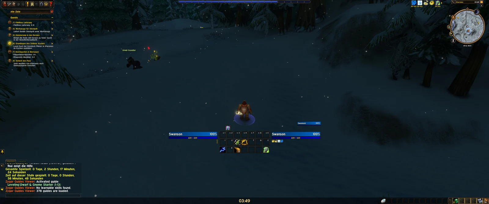

# ForeverBuddyUI 1.0.25

Eine reduzierte Spieloberfläche mit rahmenlosen Einheitentafeln mit weichen Kanten, eigenen Zauberleisten, Klassenressourcen und einer dunklen Fußleiste.

**Client:** WoW Forever · **Interface:** 16001 · **Eigenständig:** keine zusätzlichen Addons erforderlich.

**Layout-Auflösung:** Das Setup erkennt die Auflösung und bietet Vorlagen für **3440 × 1440**, **2560 × 1440** und **1920 × 1080**.

[Wago](https://addons.wago.io/addons/foreverbuddyui) · [CurseForge](https://www.curseforge.com/wow/addons/foreverbuddyui) · [GitHub Releases](https://github.com/norushflow/ForeverBuddyUI/releases)

## Einblicke

[Forever-Oberfläche im Kampf mit Zauberleisten](branding/screenshots/combat.webp) · [Gruppen- und Schlachtzugsansicht in Forever](branding/screenshots/raid.webp)

Mit `/fbui groupframes off` kannst du Blizzards Gruppen- und Schlachtzugsfenster selbst anordnen oder ein anderes Addon verwenden. `/fbui groupframes on` aktiviert die ForeverBuddyUI-Fenster wieder. Die Einstellung gilt accountweit. Beim Umschalten lädt die Oberfläche neu.

## Funktionen

- Eigene Spieler-, Ziel-, Fokus-, Gruppen- und Raidrahmen.
- Questfortschritt passender Ziele direkt rechts neben ihrem Welt-Nameplate.
- Zauberleisten und Klassenressourcen mit der WoW-Nameplate-Textur.
- Halbtransparente schwarze Fußleiste mit goldener Uhr und bronzefarbene Aktionsknopf-Ränder.
- Native Minimap, Tracking, Chat sowie Erfahrungs- und Rufleisten.

## Sprachen und aktueller Stand

Die Spielsprache bestimmt die Texte: Deutsch (`deDE`), Englisch (`enUS`, `enGB`), sonst Englisch. Die gemeinsame Codebasis lädt `Locales/enUS.lua` und anschließend die deutschen Übersetzungen. Namen aus Blizzard-APIs (z. B. Gegenstände, Zauber und Klassen) folgen weiterhin der Clientsprache.

- Automatische Sicherung der Aktionsleisten und nativen Klickzauber in `ForeverbuddyuiCharDB.actions`, unabhängig von Klasse, Spezialisierung, Rolle, Talenten und Stufe.
- Erste Anmeldung übernimmt die aktuelle Belegung; spätere Anmeldungen stellen sie wieder her. Änderungen werden ereignisgesteuert gespeichert.
- Kampf, Sonderleisten und belegter Mauszeiger verschieben die Wiederherstellung; API-Ablehnungen werden geprüft, alte Daten bleiben erhalten. `/fbui restore` erlaubt einen manuellen Wiederholungsversuch.

Die Sicherung funktioniert bereits ab Stufe 1 ohne Spezialisierungs-API. Es gibt keine neuen Profile oder Auswahlfenster. Die nativen Leisten behalten ihre Anordnung und Bedienung. Allgemeine Makros und unbekannte Aktionstypen werden nicht übernommen; Charakter-Makros werden anhand ihres Namens zugeordnet. Fehlende Zauber, Makros und nicht verfügbare APIs können nicht erzwungen werden. Besitz-/reservierte Plätze bleiben beim Laden unangetastet. Bei deaktiviertem Addon-Layout (`/fbui off`) pausiert auch die Sicherung.

Die erste Sicherung verwendet die aktuelle Charakterbelegung, nicht eine möglicherweise fremde Klassenvorlage aus ForeverBuddy. Sind beide Addons aktiv, überlässt ForeverBuddy die automatische Wiederherstellung ForeverBuddyUI; seine manuellen Vorlagen bleiben verfügbar.

## Installation

Das Installations-ZIP unter [Releases](https://github.com/norushflow/ForeverBuddyUI/releases) herunterladen und den enthaltenen Ordner `Foreverbuddyui` in `Interface/AddOns/` des passenden Spielclients entpacken. Die Datei `Foreverbuddyui.toc` muss direkt in diesem Ordner liegen. Anschließend im Spiel aktivieren und `/reload` ausführen.

Für WowUp die [Repository-Adresse](https://github.com/norushflow/ForeverBuddyUI) importieren und den passenden Spielclient wählen.

## Bedienung

Auf jedem neuen Charakter und nach jedem Versionsupdate erscheint beim nächsten Login einmal pro Charakter das Setupfenster. Schließen überspringt die Einrichtung für diese Version. Im Kampf wartet das Fenster bis zum Kampfende; ein deaktiviertes UI öffnet es nur auf ausdrücklichen Aufruf.

**Vorsicht: Layout wird überschrieben!** Mit **One Button Setup** wird **ForeverBuddyUI** durch die mitgelieferte Vorlage ersetzt und ausgewählt. Eigene Änderungen an diesem Layout gehen verloren. Andere Layouts bleiben erhalten. Der Login und das bloße Öffnen des Fensters verändern keine Layoutdaten.

- `/fbui on`: Setupfenster mit Überschreibwarnung öffnen.
- `/fbui off`: eigenes UI deaktivieren; `/fbui reset`: Positionen zurücksetzen.
- `/fbui layoutstatus`: vorhandene und aktive Blizzard-Layouts anzeigen.
- `/fbui`: Hilfe anzeigen.

Vor dem Setup den Blizzard-Bearbeitungsmodus schließen. Nach der Layoutaktivierung über die Schaltfläche neu laden oder im Chat `/reload` eingeben.

## Änderungen und Entwicklung

Die [Versionshistorie](CHANGELOG.md) enthält ausschließlich Änderungen am Addon.
Prüfungen, Paketbau und noch offene Spieltests stehen in [Entwicklung und Release](DEVELOPMENT.md).

Nach diesem Update WoW vollständig neu starten, damit das Icon in der Addonübersicht neu eingelesen wird.

Nach Installation dieses Updates WoW vollständig neu starten, damit die neue charakterbezogene Speicherung geladen wird. Der bisherige accountweite Setupstatus wird nicht übernommen; deshalb erscheint das Fenster auch auf bestehenden Charakteren einmal erneut.
